# 示范采集与示范学习：页面和使用指南

两张卡片在 PhanthyMotus 原画布内打开内嵌页面。已有视频可以直接进入「示范学习」；现场录像可以先经过「示范采集」，保存后继续分析、整理步骤和提炼任务技能。

本文截图来自真实 Canvas、iframe、Core API 与 Perception 进程的浏览器测试。视频为 FFmpeg 合成测试图案，轨迹和 ROS 消息为合成数据，模型回复使用固定测试响应。截图展示交互与数据流，不作为真实视频理解、机器人执行或策略学习的效果证明。没有包含 API Key、私人示范或第三方视频帧。

## 1. 从哪里打开

在左侧 Perception 工具列表中找到「示范学习」和「示范采集」，拖入原画布，点击卡片上的 **打开工作台**。这两个卡片不再列出内部 action 和参数表单。

| 想做什么 | 打开哪里 | 首次需要准备什么 |
| --- | --- | --- |
| 看已有视频、手工整理步骤 | 示范学习 → 视频 | 一段不超过 64 MiB 的视频 |
| 让模型分析、提炼通用做法 | 示范学习 → 模型设置 | 可用服务、模型和 API Key |
| 录制现场示范 | 示范采集 | 画布连接已在发布数据的相机，可选连接状态来源 |
| 比较、复用已有任务技能 | 示范学习 → 技能 | 已提炼的技能；不必重新上传视频 |
| 记录实际执行结果 | 示范学习 → 复盘 | 人工观察，可选补充执行录像 |

打开工作台、导入视频不要求先「开启智能控制」。现场采集有自己的「开启采集预览」按钮。原有普通动作的运行限制仍然保留。

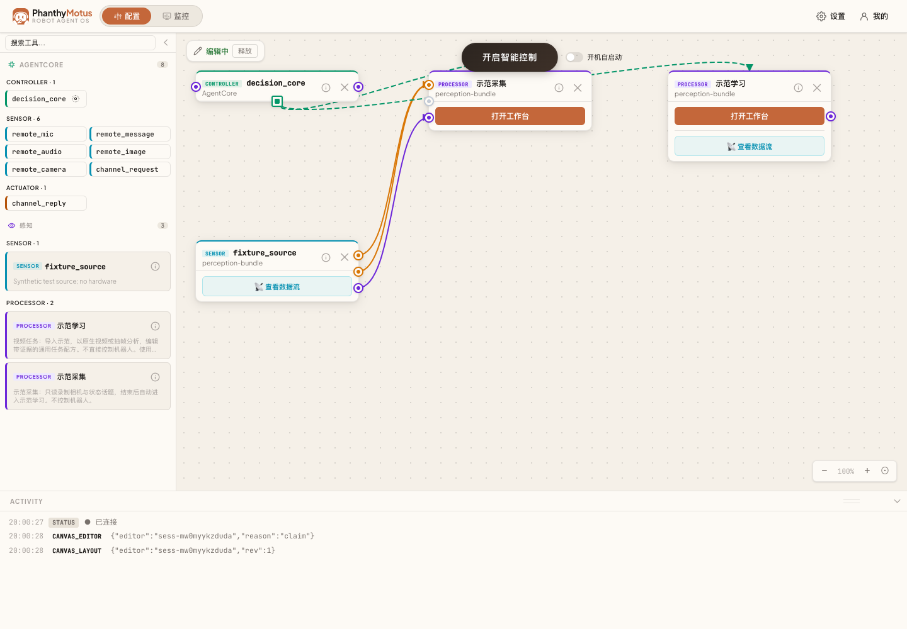

图中的 Synthetic fixture 是测试专用数据源，产品部署时使用实际相机／状态卡片。

## 2. 最短路径：导入视频 → 查看步骤

1. 打开「示范学习」，在 **视频** 页点击「选择视频文件」，也可以拖入视频或粘贴链接。导入后会生成一份示范，后续可从左上角切换。
2. 播放视频，必要时填写「希望重点看什么？」。不填也可以分析。
3. 首次调用模型前，点击右上角「模型设置」完成下一节的配置。
4. 点击「分析这个视频」。在分析方式中选择「分段抽帧」或「原生视频」，点击「开始分析」。片段范围和采样参数默认折叠。
5. 在 **步骤** 页回看建议，检查每一步对应的视频片段、前置条件和完成条件，明确采用后作为当前任务。

没有模型也可以导入和播放视频，点击「手工编写步骤」整理做法。模型分析、技能提炼、语义比较和改进建议需要可用模型。

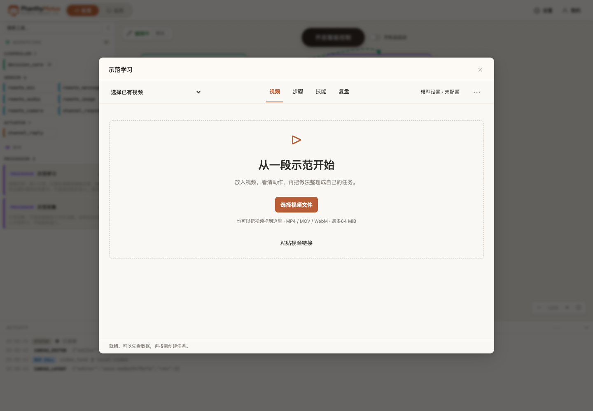

### 模型配置就在页面右上角

1. 点击「模型设置」。
2. 选择服务：PhanthyRouter · Gemini、Gemini 官方 API，或其他兼容服务。
3. PhanthyRouter 会读取公开模型目录，选择账号可用的模型，输入 API Key，点击「保存设置」。自定义模型 ID、接口地址和协议在「高级设置」中。
4. 保存后重新打开，已保存的 Key 不会回显；留空会保留它。配置沿用 Core 的工具配置存储，无需再找侧边栏的第二套设置。

保存设置不会调用模型。目录列出模型只代表服务声明了对应接口，不证明当前账号有权限或该模型能接收视频。截图中的目录和模型回复均为测试数据，部署时以实际服务返回为准。

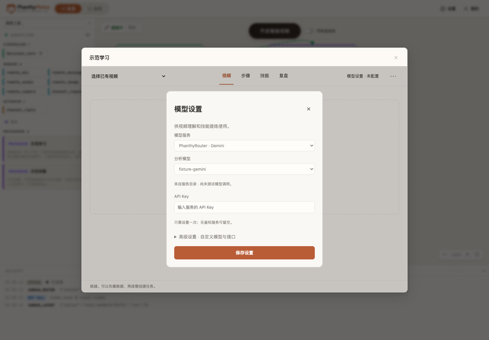

| 分析方式 | 输入 | 适合的检查 |
| --- | --- | --- |
| 分段抽帧 | 带时间信息的图像序列 | 查看具体动作、核对某一步、控制帧预算 |
| 原生视频 | 裁剪和缩放后的 MP4 视觉片段 | 检查时间上的动作变化；本实现不传音频 |
| 原生／抽帧对照 | 同一示范的两次独立分析 | 人工比较遗漏、步骤边界与疑点；会产生两次模型请求 |

Gemini 协议支持两种输入路径；兼容接口默认只使用抽帧。服务明确支持 Qwen `video_url` 后，才在高级设置中声明兼容原生视频协议。原生请求失败会报告错误，不会悄悄改为抽帧。

### 当前步骤与历史分析分开

**步骤** 页以当前任务为主。点击某一步回看片段，进入编辑后可以修改标题、拖动时间边界、补充依据与完成条件，最后点击「保存修改」。新生成的建议不会自动覆盖已经采用的做法。

过去的分析放在「历史分析」中；查看历史不等于采用历史。回到当前结果后继续编辑，不需要在多个相似折叠面板中猜哪一份生效。

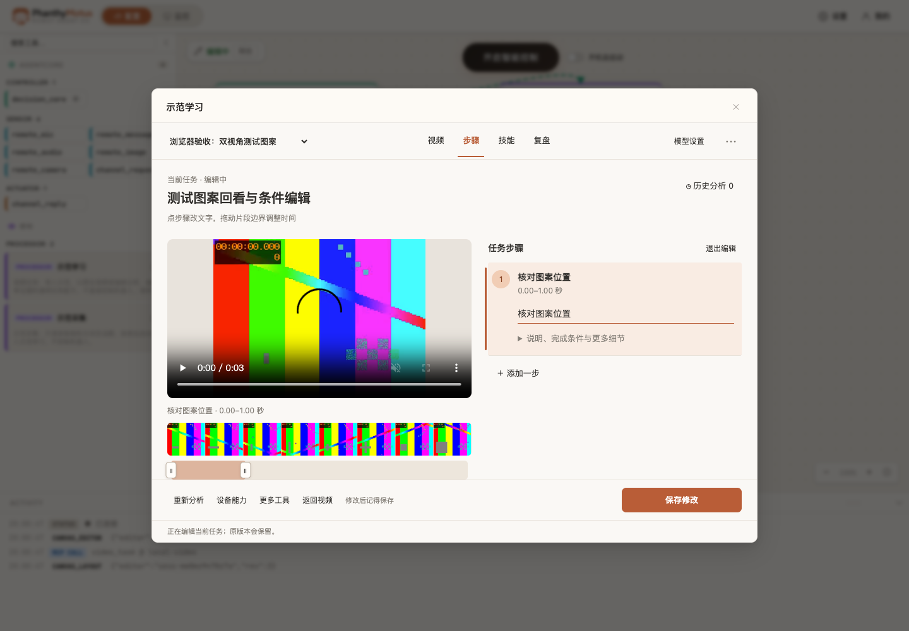

## 3. 多视角、关键点、Ego 与 UMI

这些能力放在「视频 → 观察工具」中，按需展开，不额外增加卡片。

### 多视角

1. 先导入主视频，在「多视角」中添加「同次视角」。
2. 选择辅助视频的角色，例如 Ego 视角或外部视角。
3. 拖动时间条，让同一个动作同时出现；需要时展开精确偏移与两点漂移校准。
4. 人工核对后勾选「已核对同步」，点击「保存同步」。

只有已确认同步的辅助证据会参与对应分析。当前一次分析最多补充两路辅助视角、每路两帧；并非无限路原生视频联合推理。修改同步或源数据后，旧候选不能冒充当前证据直接采用。

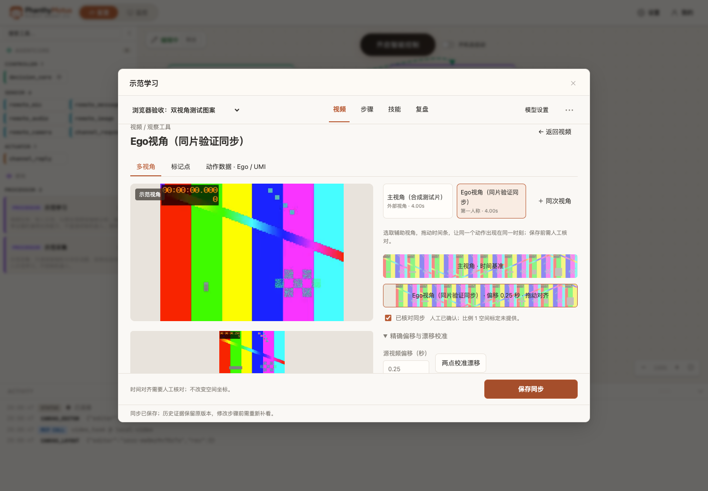

### 标记点与跟踪

在「标记点」中开启点选，点击画面并命名，可仅保存人工标注，也可以跟踪这些点。单次跟踪最多 30 秒。「检测手部并跟踪」复用已有 pose 引擎，需要该引擎可用；没有它仍可人工点选。

人工标注和算法跟踪分开记录。遮挡后可能失跟，页面不把它当作接触力、左右手身份或经过标定的机器人位姿。

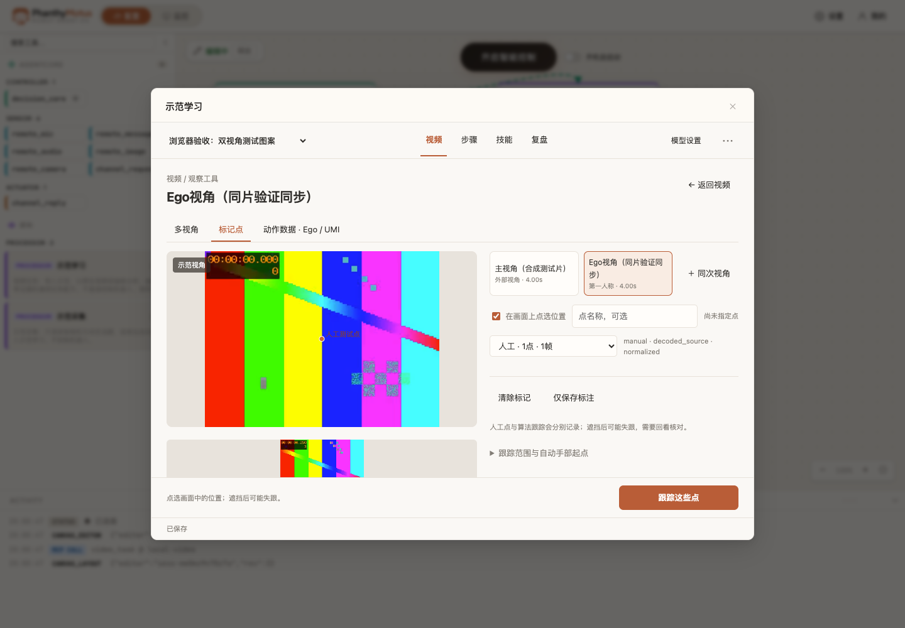

### EgoDex / UMI 动作数据

1. 先导入对应视频，再打开「动作数据 · Ego / UMI」。
2. 点击「导入动作数据」，选择格式、时间区间及源帧率；UMI 必须声明处理后的坐标系。
3. 导入后旋转查看三维轨迹，对照视频检查时间、坐标、缺失点及夹爪变化。
4. 点击「结合动作分析」，把有来源、时间和质量信息的数值摘要交给模型；也可以「导出轨迹」。

| 格式 | 当前读取内容 | 需要注意 |
| --- | --- | --- |
| EgoDex HDF5 | `transforms` 中 N×4×4 变换，可选置信度、相机内参 | 需要 `h5py`；保留 ARKit session 坐标，不能跨 episode 当成同一个世界原点 |
| UMI NPZ | `robotN_eef_pos`、`robotN_eef_rot_axis_angle`、`robotN_gripper_width`，可选 `episode_ends` | 数值数组；不接受 pickle；声明 fps 和坐标系 |
| UMI Zarr ZIP | `data` 中上述数组与 `meta/episode_ends` | 需要 Zarr 2.x；先导出短 episode 的数值数据，图像另作视频导入 |
| 轨迹 JSON | 有时间、点名、坐标系和单位的结构化轨迹 | 格式与校验见 [tracks.py](../perception/plugins/video_task/tracks.py) |

单份轨迹最多 3,000 帧、80 个点；上传和 ZIP 解压后大小均受限制。原始 UMI GoPro／IMU 不会在这里恢复 SLAM，Ego 视频也不会凭空得到三维手部真值。示例数组见 [导入与动作证据测试](../perception/tests/test_video_workbench_features.py)。

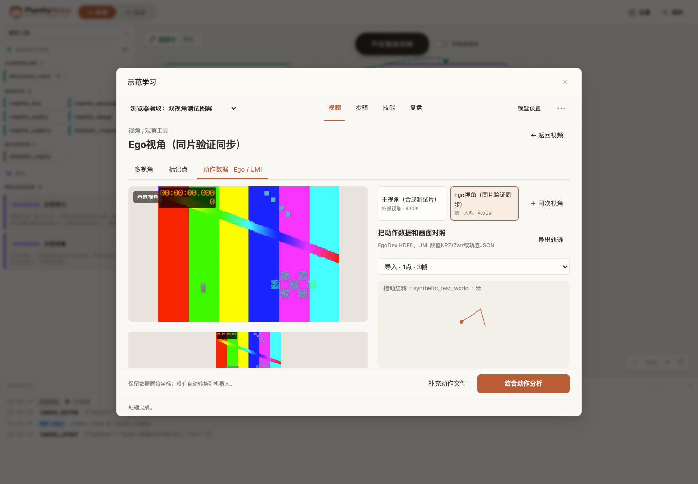

## 4. 从一次示范提炼可复用技能

1. 先核对并采用当前步骤，在步骤页点击「从当前步骤提炼」。也可以在技能页的「更多」中选择多个示范归纳。
2. **技能** 页展示适用范围、可替换参数、通用步骤、不适用情况和示范依据。检查模型是否把一次示范里的特例误当成通用规则。
3. 可以「比较已有技能」，查看复用、补充或独立保留的建议及冲突。普通文字技能会作为参考，不会被假定成有完整参数结构的任务技能。
4. 点击「确认并入库」，通过原有技能导入 API 保存。需要修改时生成新版本，已导出的版本保持不变。

这里的 skill 是可参数化的任务做法，不是训练后的运动策略。一次示范不证明泛化成立。

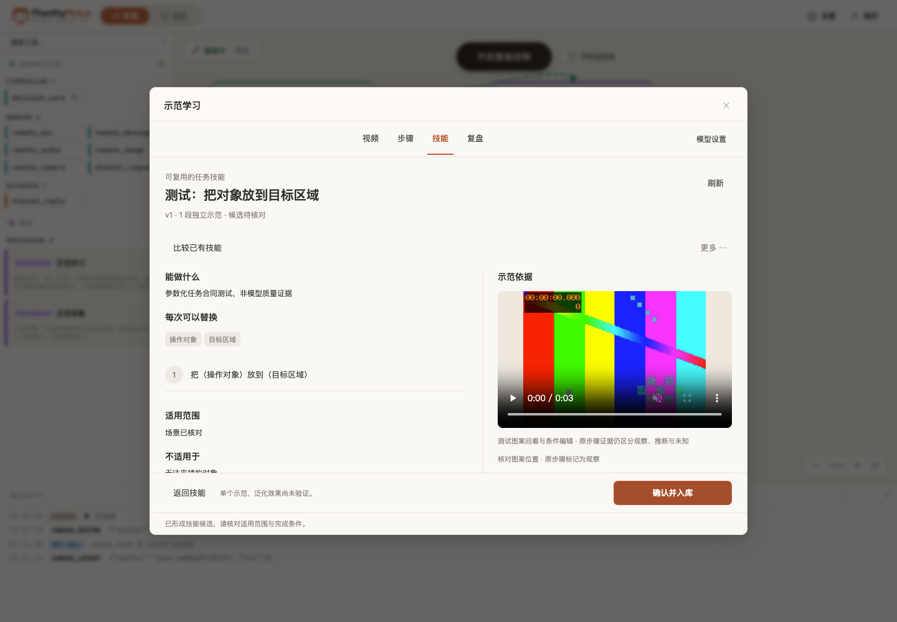

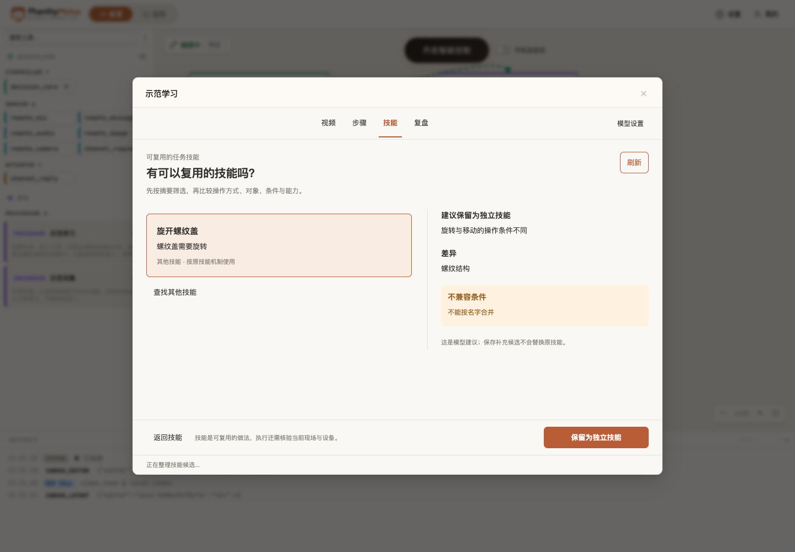

### 下次怎么使用

1. 在技能页选择已经入库的技能，点击「用于新任务」。
2. 填本次对象和目标，例如「本次蓝杯」「右侧托盘」，查看生成的任务。
3. 按页面提示补充本次现场位置、坐标系、观察依据，以及现有设备工具和停止／完成反馈。
4. 能力检查通过后，再经原有 Agent 入口请求执行。视频里的时间、位姿和设备绑定不会直接复制成本次任务的现场参数。

读取已连接工具，需要在原画布将对应工具和示范学习连接到同一决策核心。检查只核对声明与现场信息，不证明驱动实际运动可行。当前现场证据按 5 分钟新鲜度检查；场景改变后需要重新核验。

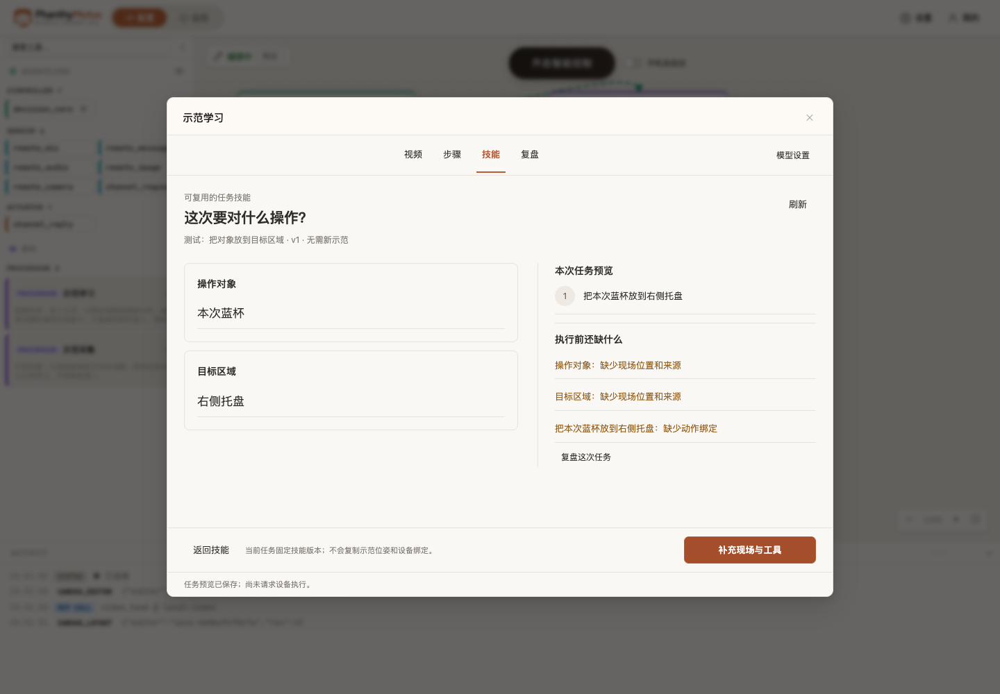

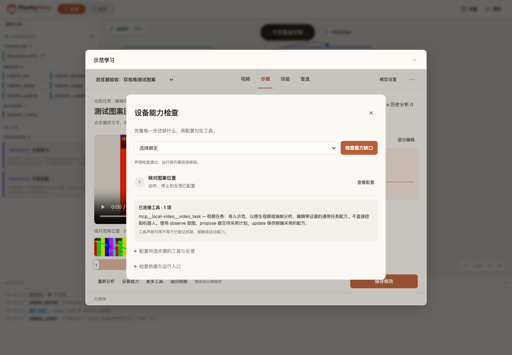

## 5. 示范采集：预览 → 录制 → 保存

1. 在画布将实际相机输出连接到「示范采集」的图像输入；可选连接关节、末端或夹爪状态。
2. 打开工作台，点击「开启采集预览」，确认能看到画面。页面沿用画布连线，无需填写 ROS topic。
3. 点击「开始录制」。可选展开设置修改示范名与视角角色；默认只看画面和动作状态。
4. 必要时点击「标记人工干预」，留下时间标记。
5. 点击「结束并保存」。整理完成后显示「示范已保存」，打开「示范学习」，从示范列表选择刚才的录制，继续分析。

关闭内嵌页面不结束正在进行的录制；重新打开可继续结束和保存。保存失败时保留原始材料，并提供重试入口。

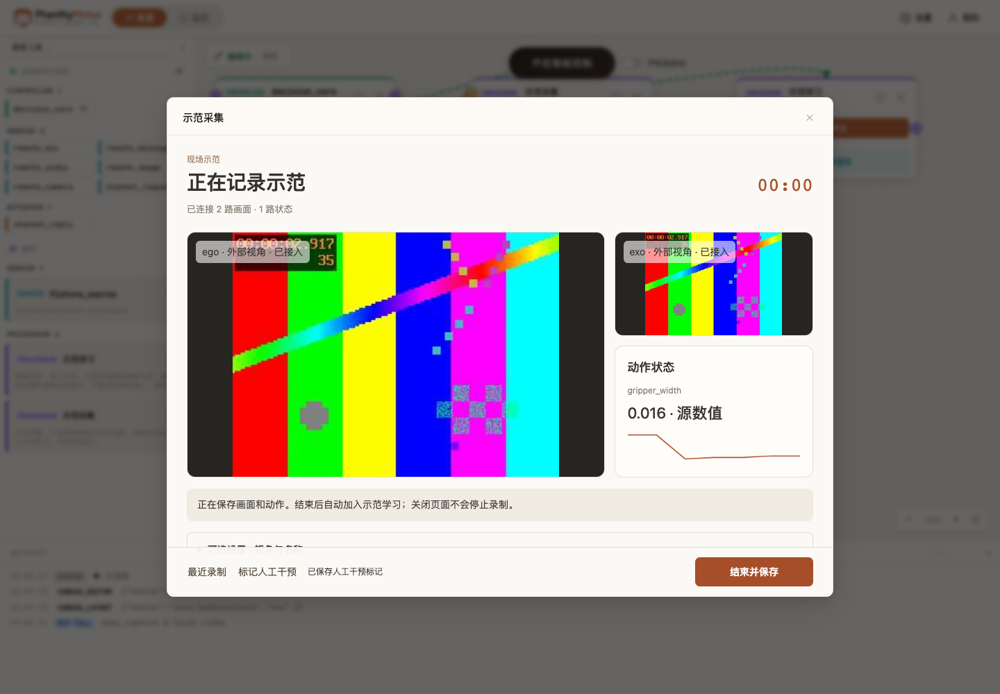

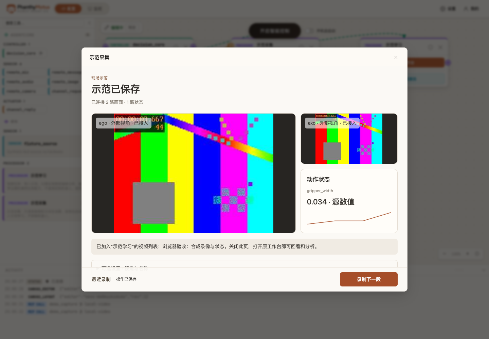

支持 JPEG `sensor_msgs/CompressedImage`、`sensor_msgs/JointState` 和 JSON `std_msgs/String`。最多 3 路相机、4 路状态；接收采样上限分别为 10 Hz 和 30 Hz，单次最多 120 秒／256 MiB。

相机驱动需已经发布对应消息。「开启采集预览」订阅已连接来源，不负责启动设备驱动。记录按本机接收时间对齐，质量信息中保留丢帧／缺失等情况；这不等于硬件同步或空间标定，也不会发送机器人运动命令。

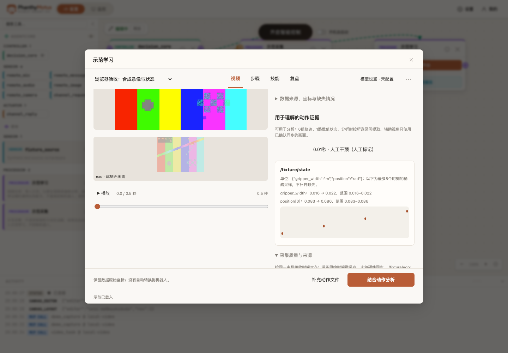

## 6. 复盘和改进候选

在 **复盘** 页选择步骤，可导入执行录像与参考示范并排查看，也可只记录人工观察。两段视频使用独立时间轴，不默认把示范时间当作实际执行时间。

选择「完成」「需重试／失败」或「不确定」，补充实际观察，先保存反馈，再按需生成改进候选。技能任务的反馈属于具体任务和技能版本，不会替换原技能。

模型生成的是待核验建议。回归检查、人工采用和推荐版本是独立步骤；本实现不会自动训练策略或自行把候选升级为已验证技能。

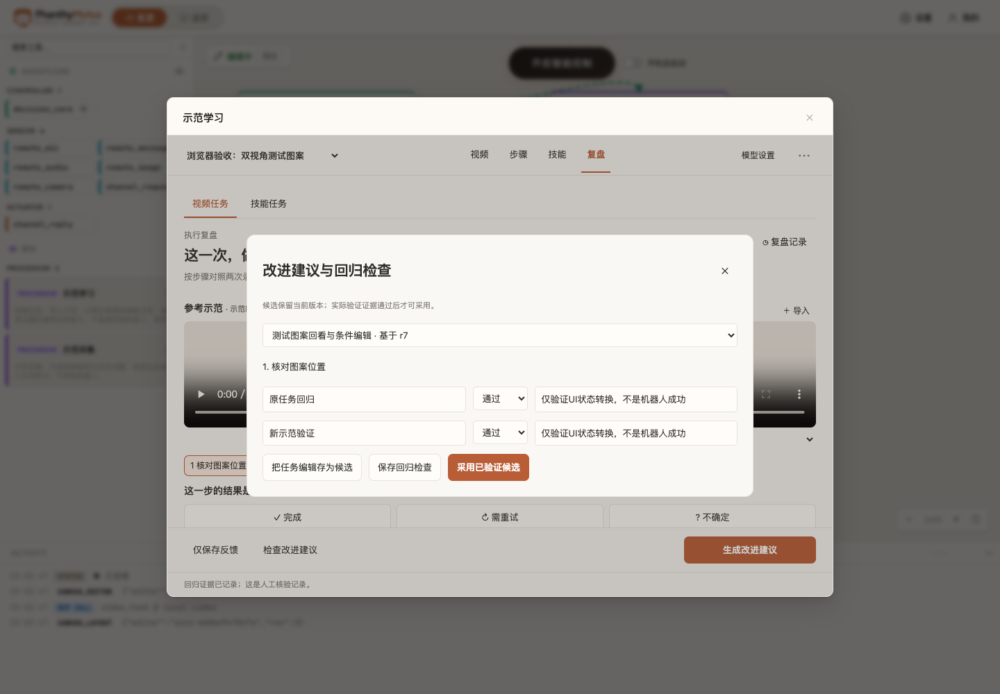

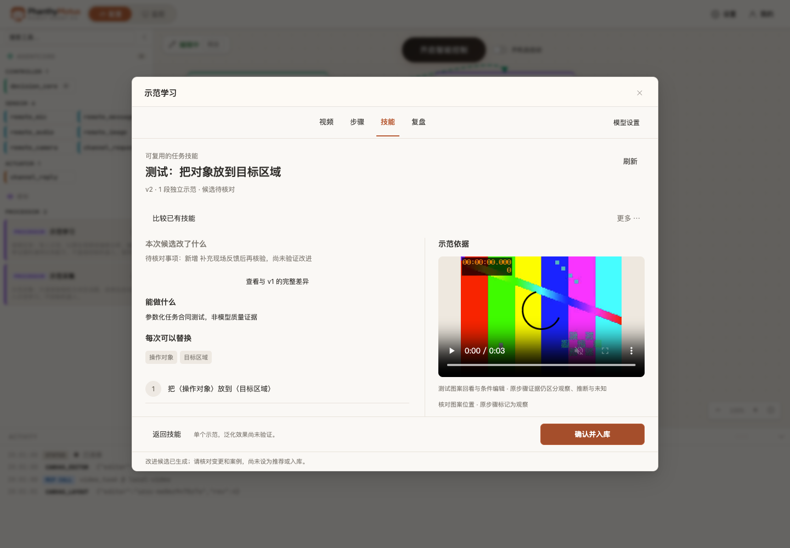

页面也适配窄屏，主操作保留在底部：

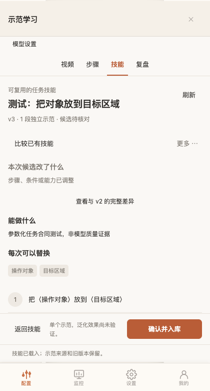

## 7. 部署和数据位置

需要同时使用本改动中的 Core 和 Perception。实现位于已有 `perception/plugins/video_task/`，由现有 Perception MCP 服务注册，未增加独立服务或 Driver。

`perception/config.yaml` 默认启用 `video_task` 和 `demo_capture`。示范、技能版本、录制材料保存在 `video_task.data_dir`，默认 `/models/video_task`；上传暂存由现有 file intake 管理，默认 `/models/uploads`。升级时应保留这些持久目录。

| 依赖 | 用途 | 当前部署要求 |
| --- | --- | --- |
| FFmpeg、OpenCV、NumPy | 视频导入、时间索引、预览、数值处理 | 现有 Jetson Dockerfile 已有 FFmpeg 和视觉环境；其他运行环境自行确认可用 |
| `h5py` | EgoDex HDF5 导入 | 可选，不自动安装 |
| `zarr<3` | UMI Zarr ZIP 导入 | 可选，当前适配 Zarr 2.x；NPZ 不需要它 |
| `yt-dlp` | 部分网页视频链接下载 | 可选；网站访问／登录限制仍可能使下载失败，可改为本地文件上传 |
| ROS 2 Python 消息与运行环境 | 现场采集 | 使用现有 Perception 环境；本地浏览器测试使用显式消息替身 |
| 模型 API | 分析、提炼、语义比较、改进 | 在内嵌模型设置中配置；不安装本地大模型权重 |

可选包应按部署镜像的 Python／NumPy 版本安装；本 PR 未升级 Jetson 的 NumPy、GPU 或 ROS 依赖。`data_dir`、上传根目录等是部署参数，不出现在普通用户的模型设置里。

## 8. 常见问题

| 现象 | 检查哪里 |
| --- | --- |
| 看不到两个卡片 | Perception 是否更新并在线，两个插件是否启用，Core 是否刷新了工具列表 |
| 没找到模型配置 | 示范学习右上角「模型设置」，不是侧边栏齿轮 |
| 保存模型配置被拒绝 | 先停止项目、取得编辑权，并等待当前分析结束 |
| 原生视频请求失败 | 确认模型账号权限、接口协议和服务的视频支持；可手动选择抽帧重试 |
| 导入链接失败 | 检查网页下载依赖和站点访问限制，或上传已获得的视频文件 |
| 采集预览没有画面 | 检查画布连线、相机正在发布 JPEG 消息、消息类型是否匹配 |
| 动作数据导入被拒绝 | 检查可选依赖、帧率、坐标系、episode、数组字段和大小限制 |
| 新任务提示缺现场位置／工具 | 补充当前场景并绑定原工具，示范本身不提供本次执行授权 |
| 分析结果很多 | 当前步骤只有一份；旧分析在「历史分析」里，查看不会替换当前结果 |

## 9. 开发者验证与截图复现

测试使用真实视频编码、HTTP、存储和浏览器交互；ROS、模型响应由明确的测试替身提供。本次验证环境是 macOS、Python 3.10、Chrome，未完成 Jetson 镜像构建或实体机器人验收。

2026-11-03 在主分支 `fc64fbc` 上整合后的验证：Perception 61 项、Core／浏览器／技能与文件代理 55 项、新版 ModelHub／画布相邻检查 47 项，共 163 项不同测试通过。补充截图后重复运行的两项浏览器用例不重复计数。Core 原有 `layout.dict()` 产生 4 条 Pydantic 弃用警告。

从仓库根目录分开运行两组测试（两侧都有名为 `plugins` 的顶层包）：

```sh
python -m pytest perception/tests/test_video_task.py perception/tests/test_video_skill.py perception/tests/test_video_workbench_features.py perception/tests/test_demo_capture.py -q

VIDEO_WORKBENCH_ARTIFACT_DIR=/tmp/motus-demo-screens python -m pytest agent-core/tests/test_video_workbench.py agent-core/tests/test_skill_import.py agent-core/tests/test_skill_execution.py agent-core/tests/test_mcp_file_proxy.py agent-core/tests/test_mcp_file_args.py -q

python -m pytest agent-core/tests/test_modelhub_link.py agent-core/tests/test_peer_canvas_gate.py agent-core/tests/test_canvas_editor_idle.py agent-core/tests/test_canvas_toolbar_touch.py -q
```

开发环境需安装各侧现有依赖；额外测试依赖包括 pytest、Playwright／Chromium、imageio-ffmpeg、OpenCV、h5py、Zarr 2.x、aiofiles、cryptography。检查结果应确认浏览器和可选格式测试实际运行，不能把因缺包跳过当成通过。

浏览器测试输出整个原画布和内嵌页截图。图片的内容、使用的替身及复现文件见 [截图说明](images/DEMONSTRATION_SCREENSHOTS.md)。

### Core 改动边界

| 文件 | 必要原因 |
| --- | --- |
| `agent-core/web/js/workbench.js` | 在现有 iframe 协议中按声明授权上传、媒体、只读工具／技能查询、当前卡片输入和自己的模型配置；保留 ModelHub 入口 |
| `agent-core/web/js/canvas.js` | 用卡片声明显示一个「打开工作台」入口，允许项目停止时打开，提供当前卡片连线 |
| `agent-core/web/js/sidebar.js` | 展示卡片中文标题；完整由内嵌页管理的可选配置不重复显示齿轮 |
| `agent-core/src/api/mcp_manage.py` | 有限大小的卡片媒体代理，以及 Python 3.10 上传流兼容 |

Agent 主循环、规划策略、机器人 Driver 和现有技能执行授权不在本次修改范围。媒体代理只接收声明过能力的卡片资源 ID，不接收任意 URL／文件路径；iframe 的直接网络访问仍被 CSP 禁止。
