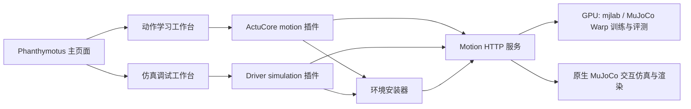

# SuperMimic 动作学习与 MuJoCo 仿真使用指南

本文说明本次接入实际支持的操作、服务器部署方式和能力边界。先阅读本页的“当前能做什么”，再根据是否已有 Motion 服务选择连接路径。代码审阅与验收入口见 [REVIEW_GUIDE_ZH.md](REVIEW_GUIDE_ZH.md)。

文中的主机名、用户、路径均为示例；`<...>` 需要替换为管理员提供的实际值。仓库不包含服务凭证、SSH 私钥、机器人资产包、训练动作或可直接使用的成熟策略。

## 1. 当前能做什么

| 入口 | 用途 | 不代表什么 |
| --- | --- | --- |
| ActuCore `motion`：动作学习 | 导入参考动作、预览、训练、查看训练采样画面、管理训练版本、检查模型、导出模型包、策略试跑 | 预览参考动作不代表策略已经学会；训练结束不代表模型合格 |
| Driver `simulation`：仿真调试 | 查看或创建 MuJoCo 会话，加载策略，运行、暂停、单步、扰动、录制及回放 | 不向实体机器人发命令；仿真录制尚不能直接转换为训练数据 |
| 环境准备页面 | 检查管理员登记的服务器，复用已有环境或安装固定 G1 环境，查看阶段和日志 | 不是在浏览器任意输入 SSH 地址、执行任意命令的远程终端 |

目前完整接通的是 **Unitree G1、50 Hz、单个参考动作绑定的 motion 策略**。每次训练任务选一个动作，模型绑定这份动作和机器人配置。单机可以使用 1–8 张已授权 GPU；没有跨服务器多机训练。

SuperMimic 官方支持多动作和速度指令任务，本工作台尚未把多动作集合、速度／方向控制导出与运行、录制到训练数据转换接通。跑步动作跟踪与“随时加速、转弯、停止”需要分别验收。本次不包含实体机器人部署。

现有联调样例是人工生成的短动作，仅用于检查数据、训练、推理和显示链路；已有短训样例策略会摔倒。不要把它们作为稳定站立、跑步或动作质量的交付结果。

## 2. 两张卡片如何配合



两张卡片应连接同一个 Motion 服务，才能看到同一份动作、模型和会话。训练、推理和渲染在服务器执行；浏览器显示服务端返回的 JPEG，并通过现有工作台桥提交操作。

正式使用入口是 **Phanthymotus 主页面内的弹窗工作台**：

1. 部署本次主仓库 PR 的工作台宿主与 ActuCore，以及配套 Driver PR 中的 `simulator/mujoco` bundle。主 PR 包含一处通用工作台 `config` 桥接，用于保存服务连接和环境引用；只复制插件、保留缺少该消息处理的旧宿主，会导致连接配置流程不完整。
2. 确认 `actucore/config.yaml` 中 `plugins.motion.enabled: true`，Driver 中 `plugins.simulation.enabled: true`。启动或重新加载对应 bundle，使工具注册到主页面。
3. 在画布添加 `motion` 和 `simulation` 卡片。ActuCore MCP 默认端口为 `15730`；仿真 Driver MCP 默认端口为 `15712`。
4. 卡片操作选择 `ui` 并执行，在主页面弹出工作台。无需把训练卡连到实体机器人命令口，也无需启动整个项目来预览和管理训练。
5. 先在动作学习卡完成连接、导入和训练；需要更多物理诊断时，再打开仿真调试卡。

仅打开卡片、查看动作或启动 bundle，不会自动训练或执行机器人策略。

## 3. 先分清三种连接

| 连接 | 谁使用 | 地址／端口示例 | 凭证 |
| --- | --- | --- | --- |
| SSH 管理连接 | 管理员部署、检查服务器 | `<gpu-host>:<ssh-port>` | 管理员自己的 SSH 账号和私钥 |
| Motion 服务连接 | 两个卡片的后端插件 | `http://gpu-service.internal:15732` | `MOTION_API_TOKEN` |
| 环境安装器连接 | 两个卡片的后端插件 | `http://gpu-manager.internal:15734` | `MOTION_ENVIRONMENT_TOKEN` |

工作台“服务地址”填写 **HTTP(S) Motion API 地址**，不是 SSH 地址，也不是 SuperMimic 项目目录。SSH 私钥不上传到工作台。安装器和 Motion 服务使用不同凭证；主页面登录凭证也不等于这两个凭证。

网络连通性以 **ActuCore／Driver 后端进程所在的位置** 为准：

- `127.0.0.1` 指调用者自己。ActuCore 在容器中时，这个地址通常不是宿主机或另一台 GPU 服务器。
- 工作台 iframe 不直接访问 GPU 服务器；操作员浏览器能打开某个地址，不足以证明后端能访问。
- 管理员应提供后端可达的内网地址或已配置的 HTTPS 反向代理地址。
- 独立安装配方返回 Docker 默认 bridge 上的容器地址，**不自动发布宿主机端口**。另一台主机上的 ActuCore／Driver 通常不能直接使用该地址。需要管理员先提供受控网络路由或代理，再手动连接对应地址；本次安装器不自动建立这些跨主机网络。

## 4. 已有 Motion 服务：直接连接

管理员提供服务地址、服务凭证，以及该服务的机器人配置。随后分别在两张卡片中：

1. 打开右上角“连接”。
2. 展开“手动连接服务”。
3. 填写服务地址与访问凭证，点击“保存连接”。
4. 使用“测试当前连接”确认；成功后应能读取机器人、动作和模型列表。
5. 在另一张卡片保存同一服务连接。

连接已由环境安装器准备过时，可以直接在“已准备环境”中选择并点击“连接此环境”，不必重复填写服务凭证。只有成功的**准备／安装任务**会进入可连接列表；单纯“检查通过”还不是可连接环境。

已保存的服务凭证不会返回 iframe。页面空白的凭证输入框不表示凭证丢失。切换服务前先交出当前窗口的仿真控制权；切换不会删除原服务器的模型和会话。

管理员也可以在两个 bundle 的启动环境中设置：

```sh
export MOTION_SERVICE_URL='http://gpu-service.internal:15732'
export MOTION_API_TOKEN='<管理员分发的服务凭证>'
```

这些变量必须进入 **ActuCore 和仿真 Driver 进程**。只在操作员电脑的终端设置不会改变远端 bundle。不要把实际凭证写进 Git、截图或 PR。

本次部署片段为工作台状态提供持久目录。ActuCore 容器内使用 `MOTION_WORKBENCH_STATE_DIR=/var/lib/phanthymotus/motion`，宿主目录由 `MOTION_STATE_HOST_DIR` 指定，默认 `/opt/embodied/motion-workbench`。仿真卡使用自己的状态目录，详见配套 Driver README。管理员应保留这些挂载，并限制服务账户之外的读取；其中包含私有连接绑定，而不是可提交到 Git 的普通配置。

### 在后端所在机器检查连接

下面的检查只读取健康状态，不启动训练或仿真。先在同一服务账户环境中设置上述两个变量，再执行：

```sh
python3 - <<'PY'
import json
import os
import urllib.request

endpoint = os.environ['MOTION_SERVICE_URL'].rstrip('/')
request = urllib.request.Request(
    endpoint + '/health',
    headers={'Authorization': 'Bearer ' + os.environ['MOTION_API_TOKEN']},
)
with urllib.request.urlopen(request, timeout=10) as response:
    print(json.dumps(json.load(response), ensure_ascii=False, indent=2))
PY
```

## 5. 没有环境：管理员部署安装器，再从页面准备

前端可以发起安装、看到实际阶段和日志；**首次登记服务器及配置安装器仍由管理员完成**。目标机需要已有 Linux x86_64、NVIDIA 驱动、Docker 和 NVIDIA Container Toolkit，服务账户需要 Docker 权限。安装器不会安装／替换主机驱动、修改 Docker daemon，或重启其他任务。

### 5.1 管理员准备源码和机器人资产

先使用管理员已有的 SSH 入口登录目标控制环境：

```sh
ssh -p <ssh-port> <service-user>@<gpu-host>
```

本节约定管理员已把本仓库待验收版本放在 `/srv/phanthymotus`，服务账户可写 `/srv/motus`。准备目录：

```sh
mkdir -p /srv/motus/assets /srv/motus/credentials /srv/motus/environment-state
chmod 700 /srv/motus/credentials /srv/motus/environment-state
```

安装器需要一份已验证的 G1 资产包。它包含编译后的机器人模型和配置，不含训练动作或策略。已有验证过的 `profiles.json` 时，在安装了本项目依赖的环境中打包：

```sh
cd /srv/phanthymotus
PYTHONPATH=actucore python3 -m motion_environment.package_profile \
  --profile /srv/motus/g1-profile/profiles.json \
  --output /srv/motus/assets/g1.tgz
```

固定配方要求 MuJoCo `3.16.0` 的完整 G1 MJB 配置。若尚无 profile，先按第 6 节从兼容的官方运行环境提取，或由维护者提供经验证的资产包。空服务器无法仅凭一个机器人名称自动补齐所有资产；首次 profile 准备是当前部署前置条件。

### 5.2 创建安装器凭证和目标配置

生成凭证文件，已有文件时此命令会拒绝覆盖：

```sh
python3 - <<'PY'
import os
import secrets
from pathlib import Path

path = Path('/srv/motus/credentials/manager.token')
with path.open('x') as stream:
    os.chmod(path, 0o600)
    stream.write(secrets.token_urlsafe(32) + '\n')
PY
```

创建 `/srv/motus/environment-config.json`，内容按机器实际 GPU 分配调整：

```json
{
  "source_dir": "/srv/phanthymotus/actucore",
  "profile_package": "/srv/motus/assets/g1.tgz",
  "targets": [
    {
      "id": "gpu-server",
      "label": "训练服务器",
      "host": "gpu-server.internal",
      "gpu_ids": [0, 1],
      "render_gpu": 0
    }
  ]
}
```

```sh
chmod 600 /srv/motus/environment-config.json
```

`gpu_ids` 是授权给此服务调度的物理 GPU 编号，`render_gpu` 必须属于该列表。示例不是申请独占两张 GPU；实际任务仍根据空闲显存与负载决定是否能启动。

**`host` 是目标展示信息，不会自动建立 SSH 连接。** 安装器执行其所在控制环境能访问的本地 Docker 命令。把另一台服务器 IP 写入 `host` 不会让它跨服务器安装。多主机管理和跨主机路由需另行部署。

若要提供“接入已有环境”，在对应 target 中额外配置：

```json
{
  "existing": {
    "endpoint": "http://motion-runtime.internal:15732",
    "token_file": "/srv/motus/credentials/existing-motion.token",
    "container": "existing-motion-runtime",
    "python": "/opt/motion-venv/bin/python"
  }
}
```

这是 target 的一个字段，不是独立配置文件。已有凭证文件应为 `0600`，其值需与现有服务一致；容器名称和 Python 路径也必须真实存在。复用流程需要进入该容器检查 CUDA／Warp，不只检查 HTTP 可达。

### 5.3 启动安装器并连接两个 bundle

下面先使用回环监听；远端 bundle 使用时，由管理员改成受控私网监听地址或接入代理：

```sh
cd /srv/phanthymotus
PYTHONPATH=actucore python3 -m motion_environment.server \
  --host 127.0.0.1 --port 15734 \
  --root /srv/motus/environment-state \
  --config /srv/motus/environment-config.json \
  --token-file /srv/motus/credentials/manager.token
```

生产运行由现有进程管理器托管该命令。同一状态目录只启动一个安装器 HTTP 进程。请保持 `source_dir/motion_service` 是完整发布快照，避免已运行服务已更新、而后续新安装仍复制旧代码。

在 **ActuCore 和仿真 Driver** 的启动环境中设置：

```sh
export MOTION_ENVIRONMENT_URL='http://gpu-manager.internal:15734'
export MOTION_ENVIRONMENT_TOKEN='<manager.token 中的凭证>'
```

这两个变量与第 4 节的 Motion 服务连接变量相互独立。安装器允许先工作，再创建 Motion 服务。启动或重新加载 bundle 后，动作学习工作台的服务器页面应能列出“训练服务器”。

### 5.4 在主页面执行检查和安装

1. 从动作学习工作台顶部“服务器”进入“连接与准备”。
2. 选择登记好的服务器，点击“连接并检查”。
3. 查看硬件与权限检查；检查通过后，选择“接入已有环境”或“安装并继续”。也可在“环境设置”中明确选择“安装独立环境”，点击“准备所选环境”。
4. 页面显示“连接服务器 → 检查硬件与权限 → 准备训练与仿真服务 → 验证 GPU 与仿真画面”，展开“准备日志”查看实际下载、构建和验证输出。
5. 准备成功后，**再点击“连接此环境”**。成功安装不会默默替换当前连接。完整安装阶段和日志页面在动作学习卡中；仿真调试卡的连接弹窗用于选择已经准备好的环境。
6. 在仿真调试卡的“连接 → 已准备环境”中选择同一环境，点击“连接此环境”。

关闭页面后安装任务继续。重新打开可以查看任务阶段；取消通过页面“取消”执行。失败保留阶段和日志，重试会复用经过校验的缓存。安装完成仅代表 GPU 运算、G1 物理、渲染及控制协议等检查通过，**没有自动训练出模型**。至少配置两张 GPU 时，固定配方还会检查真实 NCCL 通信。

下载受限时，可以提前准备经过摘要验证的原始 wheel 缓存，详见 [环境管理说明](../../actucore/motion_environment/README.md#下载受限时准备原始包缓存)。缓存不是完整离线发行包。

## 6. 已有上游 Python 环境：手动生成 profile 并启动服务

这一节面向已具备兼容上游环境的管理员；不会把 GPU 依赖安装进机器人 ROS Python 环境。当前兼容基线为：

| 组件 | 基线 |
| --- | --- |
| Python | 3.13 |
| SuperMimic | `abc124c1bd5976341034668af3d12c087f2f1f55` |
| mjlab_research | `dd51a9fcc98791a2f0b018b3c7f71a3eefd5ecdd` |
| 固定安装配方 MuJoCo | 3.16.0 |

假设兼容 Python 位于 `/srv/motus/venv/bin/python`，管理员已准备一份上游可读取、适配 G1 的参考动作：

```sh
cd /srv/phanthymotus
mkdir -p /srv/motus/credentials
chmod 700 /srv/motus/credentials
/srv/motus/venv/bin/python -m pip install -r actucore/motion_service/requirements.txt
PYTHONPATH=actucore /srv/motus/venv/bin/python -m motion_service.prepare_profile \
  --motion-file /srv/motus/input/reference.npz \
  --output /srv/motus/g1-profile
```

输出目录必须不存在。该工具创建单个真实 GPU 环境，提取实际关节顺序、PD 参数、动作缩放、控制频率和物理配置，并导出带网格资源的场景。不要手工编一份大致相似的 profile 或仅替换模型名称。机器人包与训练数据绑定配置和模型哈希，MuJoCo 版本也要一致。

依赖安装用于补齐 ONNX Runtime、Pillow 等服务依赖，不带 `--upgrade`。核对上游和 MuJoCo 仍符合上表基线后再提取 profile；不要将为其他版本生成的 MJB 混入当前环境。

为 Motion 服务生成独立凭证：

```sh
python3 - <<'PY'
import os
import secrets
from pathlib import Path

path = Path('/srv/motus/credentials/motion.token')
with path.open('x') as stream:
    os.chmod(path, 0o600)
    stream.write(secrets.token_urlsafe(32) + '\n')
PY
```

启动服务：

```sh
cd /srv/phanthymotus
export MOTION_API_TOKEN="$(cat /srv/motus/credentials/motion.token)"
export MOTION_GPU_IDS='0,1'
export MUJOCO_GL=egl
export MUJOCO_EGL_DEVICE_ID=0
export WANDB_MODE=offline
PYTHONPATH=actucore /srv/motus/venv/bin/python -m motion_service.server \
  --host 127.0.0.1 --port 15732 \
  --profiles /srv/motus/g1-profile/profiles.json \
  --data-dir /srv/motus/motion-data
```

这启动的是服务，不是训练任务。`MOTION_GPU_IDS` 控制可调度范围，`MUJOCO_EGL_DEVICE_ID` 是容器中 EGL 可见设备索引，两者含义不同。仅暴露一张显卡的容器通常使用 EGL 索引 0。若通过 HTTPS 代理或私网监听向其他后端开放，地址必须与卡片配置一致。

服务使用本地离线日志，不要求 W&B 账号。`--worker-python` 可指定独立训练 Python，但其依赖和源码路径必须可用；默认使用服务自身 Python。

若使用已有 Docker 构建方式，参照 [服务部署说明](../../actucore/motion_service/README.md#gpu-运行环境) 和 [compose.yaml](../../actucore/motion_service/compose.yaml)。profile 中保存了模型绝对路径，Compose 必须按文件中的相同绝对路径挂载生成目录。不要混用不同 MuJoCo 版本的 MJB。

## 7. 导入与预览动作

1. 打开动作学习工作台，进入“我的动作 → 导入”。
2. 选择已加载的机器人配置，上传适配它的 `.npz` 文件。
3. 导入成功后选择该动作，检查机器人姿态、动作时长、播放进度和关节动作是否符合预期。
4. 预览时拖动视角或进度条。这里是参考数据的 MuJoCo 前向运动学显示，不会执行控制策略，也不会验证平衡能力。

当前 NPZ 必须包含：

| 字段 | 形状／约定 |
| --- | --- |
| `joint_names` | `[J]` Unicode 字符串，关节名称和顺序与 profile 完全相同 |
| `joint_pos`, `joint_vel` | `[T,J]`，单位为 rad、rad/s |
| `root_pos_w` | `[T,3]`，世界坐标位置，单位 m |
| `root_quat_w` | `[T,4]`，单位四元数，顺序 `wxyz` |
| `root_lin_vel_w`, `root_ang_vel_w` | `[T,3]`，世界坐标线速度、角速度 |
| `fps` | 一个数值，必须等于 profile 的控制频率；当前 G1 为 50 Hz |

所有逐帧数组帧数一致，数值必须有限，参考关节姿态须在配置限位内。文件最大 64 MiB，解压后最大 128 MiB；不允许 pickle 对象。当前不自动重排关节、重采样、重定向人体骨架或把视频变成训练动作。重命名扩展名不能完成转换。

一段 3 秒、50 Hz 动作为 150 帧。当前 ONNX 导出路径支持不超过 15,000 帧的绑定动作；更长数据可以提交训练，但不会因此获得可用于当前工作台试跑的 motion ONNX。

NPZ 提供“希望机器人怎样运动”的目标。训练时，物理仿真产生当前状态、控制和下一状态；世界模型学习预测这种变化，控制策略通过世界模型学习如何更好地跟踪目标，再回到物理仿真采集新的经验。世界模型和策略在循环中共同更新。输出的策略权重／ONNX 与参考动作是不同资产，运行当前 motion 策略时仍需其绑定的参考动作。

## 8. 提交训练与看训练过程

1. 选择动作，点击“训练新版本”。机器人和动作自动带入。
2. 查看预计 GPU 分配，默认保留“自动调度”。高级设置中可以选择预设、机器人实例总数和迭代次数。
3. 点击“开始训练”。保存任务 ID；页面显示排队、初始化、训练、校验、导出等真实阶段。
4. 训练开始采样后查看“训练画面”，可以看实例分组、放大单个实例或回放最近采样。展开“任务详情与日志”查看实际进度、更新次数、GPU 分配和错误。
5. 完成后进入“模型详情”检查，或在仿真里试跑。需要中止时使用“停止训练”。

“机器人实例总数”是整个任务的仿真环境数量，不是模型个数，也不是实体机器人数量。多卡时实例分配给各 rank，共同训练一份模型。手动模式下实例总数必须能被卡数整除。

自动调度只在管理员授权的 GPU 范围内选择数量和编号。页面预估与实际启动分配可能不同；真正启动前会重新检查显存和负载。临时资源不足会排队，不会结束他人的进程。训练启动后不动态扩缩卡或迁移。当前一个 Motion 服务同时运行一个训练或评测作业。

“小规模”用于较小实例数的功能联调，缩小学习批次并减少编译冷启动；“标准”保留上游学习批次与编译配置。任何预设和迭代数都不是动作质量保证。任务必须实际发生世界模型与策略更新，才能报告训练成功。

训练画面是从真实训练环境采样，再由服务器渲染。默认每 rank 最多每秒采样 4 次，全任务最多 8 个实例，保留最近 120 次采样；短窗口默认分组显示。算法更新阶段可能没有新物理帧，页面应显示原帧及采样时间。这不是 30 fps 录像，也没有训练 MP4 导出。暂停观看、切换页面或关闭弹窗不会停止训练。

服务重启后，原未完成训练任务标记为 `interrupted`，不会自动断点续训；不要把“暂停仿真”当作训练暂停功能。

## 9. 训练版本、模型检查与导出

动作页的“版本 1、版本 2……”是该动作不同训练任务产生的结果，可用于比较不同训练设置。它们不是机器人型号，也不表示系统自动提供了多个成熟算法。

推荐顺序：

**选定版本 → 模型详情 → 开始检查 → 阅读结果 → 在仿真里试跑 → 决定是否导出。**

“开始检查”在 mjlab/MuJoCo Warp 环境运行原策略，比较 ONNX 输出，并记录关节 RMSE、提前终止、超时等信息。`evaluated`／“已评估”表示检查任务执行过，不表示已经通过团队制定的质量门槛。

“导出模型包”在服务器生成包含 ONNX、绑定参考动作、profile、运行配置、哈希和已有评测报告的包。当前页面展示包信息，不会自动完成实体机器人安装或自动下载全部文件；需要文件时使用已认证的 `artifact_read` 分片接口，详见 [服务 API](../../actucore/motion_service/README.md#任务和模型)。

模型、动作、机器人配置和运行资产必须保持绑定。当前工作台不能选择一个模型，再随意换成另一个动作运行。

## 10. 在动作学习里试跑

1. 选择一个具有匹配 ONNX 的训练版本，点击“在仿真里试跑”。
2. 工作台创建或恢复对应会话，初始为暂停状态，先显示真实 MuJoCo 机器人。
3. 若显示“无人控制”或“观看中”，点击“取得控制”或明确“接管控制”。
4. 点击“开始运行”。运行中的画面来自真实物理步进和 ONNX 推理。
5. 可“暂停”、用“重新开始”重置到参考动作起点；动作完成后的“再次运行”先重置再运行。
6. 用“交出控制”立即暂停并保留会话；“结束试跑”关闭该会话。

选择版本、进入试跑页面或观看别人的会话，不会隐式开始运行。运行到动作末尾只证明该片段执行结束；机器人倒地也可能运行到末尾，因此必须结合画面和正式评测判断效果。

## 11. 仿真调试卡的独立操作

在仿真调试卡选择同一环境后，可以打开已有会话，也可以选择机器人和模型新建会话。

| 模式 | 行为 | 适合验证 |
| --- | --- | --- |
| `policy`／策略运行 | 执行所选模型，使用其绑定参考动作 | 策略输出和动作跟踪 |
| `pd_hold`／保持姿态 | PD 控制器保持配置的默认关节目标 | 机器人资产、物理、渲染和接口；不等于学会平衡 |
| `free_physics`／自由物理 | 无姿态保持控制，直接推进物理 | 重力、碰撞等物理诊断；机器人可能倒下 |

“打开观看”只读取会话，不获取控制权。控制者可以运行、暂停、单步、重置、施加扰动、开始／结束录制或关闭会话。其他窗口只有显式接管后才能操作；接管会先暂停会话，旧窗口的迟到操作会被拒绝。

工作台控制窗口每 5 秒续约，租约为 20 秒。主页面直接关闭弹窗没有可靠的即时关闭回调，服务器会在租约到期及下一检查周期暂停；想立即暂停应先点击“交出控制”。观看者关闭窗口不影响控制者。服务器重启不会恢复原物理状态，需要重新创建会话。

“录制”记录当前仿真状态，“播放录制”从所选记录帧重新渲染，回放不会改变实时物理。当前录制用于调试，保存格式为 JSONL；没有“录制 → 合格示范 → NPZ → 训练”的自动转换。录到摔倒的数据也不会自动成为稳定动作示范。

默认显示真实 MuJoCo 网格画面。拖动旋转、滚轮缩放，“居中”跟随机器人当前位置。骨架和碰撞几何是诊断视图，需要显式选择；渲染失败不会用简化画面伪装成功。

## 12. 常见问题

| 现象 | 检查与处理 |
| --- | --- |
| “未连接”、超时、连接拒绝 | 从 ActuCore／Driver 所在进程环境检查 Motion URL；确认没有把 SSH 端口、MCP 端口或错误容器的 `127.0.0.1` 当成 Motion 地址 |
| 401／凭证错误 | 核对 Motion、安装器、主页面三种凭证；管理员更换凭证后更新对应后端配置 |
| 没有已登记服务器 | 为 bundle 设置安装器 URL/token，检查安装器配置；当前界面不直接登记任意 SSH 主机 |
| 检查通过但环境列表没有它 | 继续执行准备／安装；`check` 成功本身不产生可连接环境 |
| 安装成功但连接失败 | 确认返回的 Docker bridge 地址对两个 bundle 可达；跨主机需配置网络或代理，安装器不自动发布宿主机端口 |
| 无 CUDA、无 GPU 或训练不可用 | 检查主机驱动、容器 GPU 暴露、授权 GPU 列表，以及服务实际使用的 Python 环境；CPU 只能覆盖部分本地测试，不能完成正式训练与 GPU 评测 |
| 训练一直排队 | 查看实际空闲显存和负载、授权范围及计划说明；等待资源，或减小实例数；多卡不会自动抢占已有任务 |
| 训练画面短时不动 | 查看训练迭代、rank 心跳和快照时间；学习更新不一定产生新物理状态，采样监看不是恒定帧率视频 |
| 动作导入失败 | 检查 NPZ 字段、关节顺序、50 Hz、坐标单位、wxyz、有限数值和参考姿态限位；不能靠改文件后缀解决 |
| 点运行立即报关节限位 | 先确认服务包含本次 PD 目标检查修复。旧版把期望关节目标当成实际越界；修复只适用于经过验证、有限力矩且物理约束启用的位置执行器。其他模型合同或数据错误仍应拒绝 |
| 仿真能运行但机器人摔倒 | 查看是否为联调样例／短训版本，检查数据、训练更新和评测；这不是“运行结束”就能判定合格的情况 |
| 操作提示控制权已变化 | 当前窗口只是观看者或租约已过期。读取最新状态，再明确取得／接管控制；不要在多个窗口反复争抢 |
| 模型或 profile 哈希不一致 | 恢复原绑定资产，或在新配置下重新导入、训练和检查；不要手动改哈希跳过验证 |
| 服务升级后旧会话不存在 | 交互物理会话是进程内状态；重新创建。数据、任务记录和模型应保留在原持久化数据目录 |

## 13. 仅供开发者：无 ROS 的本机工作台

下面的入口用于开发验证，不是主页面集成的替代品。需要同时签出主仓库和配套 Driver PR：

```sh
cd /path/to/phanthymotus
python3 actucore/tools/motion_workbench.py \
  --driver-root /path/to/phanthymotus-driver \
  --endpoint http://127.0.0.1:15732 \
  --token-file /path/to/motion.token
```

凭证文件须为 `0600`。浏览器打开 `http://127.0.0.1:15733`。如果使用 SSH 隧道，保持下面命令运行：

```sh
ssh -N -p <ssh-port> \
  -L 127.0.0.1:15732:127.0.0.1:15732 \
  <service-user>@<gpu-host>
```

该示例要求远端 Motion 服务监听远端宿主机的回环端口。若服务只在容器 bridge 地址上监听，应由管理员提供 SSH 主机可达的目标地址。电脑上的隧道只供本机启动器使用，不会自动让远端 ActuCore 访问该隧道。

启动器复用真实插件和页面，不依赖 ROS，不自动提交训练。它只在回环地址服务，连接调整保留到进程退出；完整主页面的注册、画布和权限行为仍需要单独验收。
