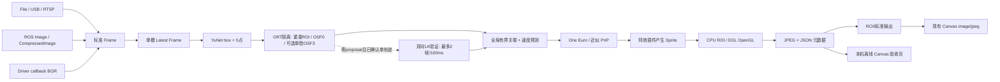

# 通用架构及实现边界

ROUND5 当前候选及证据见 [ROUND5.md](ROUND5.md)。默认兼容模型仍为 OSF0；显式配置单脸精细模型后启用下述双模型调度。质量验收仍为 NO-GO，不能把配置可用等同于真实时序/三维姿态已通过。

代码根：`perception/plugins/face_effects_live/`。核心只依赖NumPy/OpenCV及所选推理/渲染后端，不导入ROS或机器人SDK。`plugin.py`、`sources/ros.py`、`outputs.py`是平台边界。没有Driver改动；Driver现有标准ROS图像可直接接入，其他Driver帧接口通过PushSource.submit适配，而非假设有统一私有SDK方法。

## 数据、时钟、过载与资源

`Frame`是uint8 BGR、图像尺寸属性、源时间秒、递增frame_id、接收monotonic时间和来源元数据。适配器负责颜色转换和缓冲所有权。源时间仅用于平滑/排序，绝不减去主机monotonic。ROS时间戳异常由PushSource修复并计数；直接引擎输入的重复/乱序帧被拒绝。分辨率改变或大于0.5秒的源时间间隔清空跟踪/光流，不跨镜头坐标沿用贴纸。

采集与处理双线程，单待处理帧槽会覆盖旧帧。流入口PushSource也仅保留1帧；不是无界排队。处理前、渲染后、编码后均检查年龄。当前年龄从解码后接收计算，不包含传感器曝光、设备缓冲、网络解码或浏览器显示。指标明确命名receive_to_render/encode；`source_to_display_ms=null`，未伪称端到端传感器测量。

GL context创建、纹理/FBO访问及销毁由同一处理线程完成。CPU和GL消费相同Sprite命令。CPU对贴纸外接ROI做预乘alpha合成，图像无Python逐像素循环。GL缓存每个活动素材纹理，复用背景纹理/FBO；分辨率改变重建FBO。主机BGR转RGB、上传、readback都存在，不是零拷贝。没有深度缓冲人脸遮挡，也没有3D眼镜模型。

Service停止先置事件并关闭输入，再join已启动线程；推理资源在处理线程finally释放。USB后端若本地驱动永久卡在read，3秒join后报告错误并禁止同实例重启，不强杀共享进程。RTSP使用FFmpeg显式读/打开超时、0.25秒重连退避；真实驱动是否尊重超时仍须验证。ROS输入/输出节点独立创建并移出传入executor；构造失败销毁节点。多实例最多4，控制操作串行，推理不持平台控制锁。

## 模型与能力降级

- 默认推荐C：YuNet OpenCV CPU + OSF model0 ORT CPU。A省略landmark_model，有清晰稀疏定位能力上限。
- ROUND4修正：OSF session 由平台已有 `plugins.ort_worker` 的 spawn 子进程持有，Card 不在宿主创建独立 ORT session；每实例 UUID session key，只卸载自己，不关闭共享宿主。纯数值 `osf_decode.py` 在子进程解码后返回 66 点/置信度，输入张量仍有 Queue 拷贝。共享宿主重启后首个原始响应可同函数解码并恢复 postprocessor。实际 CPU/内存统计包括父子进程，平台 Sherpa 并发和硬件加速仍待验收。
- ROUND5：小/中脸传原始 uint8 ROI，子进程用 `osf_input.py` 保留先 float32 再插值的原预处理，最多8脸一次有界 RPC，仍逐脸运行 batch=1 模型。大 ROI 在父进程归一化以限制输入字节。此路径有 Queue 复制，不能称零拷贝；真实密集点及4654次自然脸观测已核对数值一致。
- `single_face_landmark_model` 需明确的本地模型路径，不自动查找或下载。所有 proposal 先用 OSF0；仅恰好1个、原结果有效、脸框短边≥96px且完整位于画面内时，再尝试精细模型。五锚点两模型平均差≤原眼距0.04且最大差≤0.08才采用精细点，否则保留原结果；多脸全部保留。守卫只用当前图像和预测，不读取标签或样本ID。快速模型默认两线程/spinning，精细模型默认单线程/不spinning；仅修改本 Card 会话选项，保留其他 Card 原调用方式和共享 worker 生命周期。
- `detect_upscale=false` 保持默认检测尺寸；可选 `detect_side=960, detect_upscale=true` 名义上最多放大2倍检测输入（另有32像素对齐），输出坐标映射到原帧。它提高部分小脸覆盖并增加计算成本，不改变原始图像或质量评分阈值；见ROUND4同条件对照。
- 缺CUDA不会阻止CPU运行。显式cuda/tensorrt请求先查EP再创建session；允许CPU降级时返回原因，strict模式拒绝静默降级。session provider列表仅说明配置，不是每个算子的实际执行设备，GPU驻留需要ORT profile证据。
- `renderer=auto`尝试EGL GL3.3；创建失败或发现llvmpipe/software时回退CPU并说明原因。`renderer=gl`严格失败。显式测试可允许软件GL验证shader正确性，不能称硬件加速。
- 缺OSF/ORT或模型无效时，不悄悄用虚构关键点；实例启动错误。操作者可以明确切换A（移除landmark_model）。模型只从已配置本地路径加载，SHA可核验，无运行时自动下载。
- GLES/EGL原生嵌入式路径、原生TensorRT engine、Vulkan、DeepStream/VPI、CUDA互操作只完成架构研究；未实现。

## 跟踪与特效质量

最多8人脸，中心/尺寸门限和速度预测代价，全局有界动态规划关联；两次命中确认。第二轮增加脸部/上身HSV直方图代价与门限，仅作为短时关联提示，轨迹内EMA，不输出或持久化特征。短丢失保留轨迹约0.35s但不渲染；歧义候选隐藏且不创建重叠复制轨迹。重新出现可能获得新ID。无外观embedding、ReID或身份承诺，两人外观相似且完全遮挡时仍可能换ID。

ROUND5 对短丢失增加了严格受限的像素跟踪例外：仅唯一已确认轨迹、检测零 proposal、距最后模型帧不超过100ms时，双向 LK 和 RANSAC 全部通过才渲染当前像素估计，最多连续2帧。失败即隐藏；时间修复、镜头切换、分辨率变化及多轨迹状态禁止桥接。输出明确标记 `flow_bridge` 与 `model_face_count=0`，不当作模型检测成功。模型来源切换重置平滑状态，保留关联 ID，防止旧模型点污染新结果。真实视频的触发数及真值缺口见ROUND5，不以合成平移 oracle 代替自然准确率。

默认按每ID平滑中心、连续角度和log眼距，保留当前帧局部表情形状；相较独立点滤波，避免快速运动时非刚体扭曲。中心滤波响应随脸占画面的比例归一化，重现或间隔超过120ms时重置。旧逐点One Euro作为可配置消融保留。没有以多帧长预测隐藏漏检。64×36灰度均差和相关性结合检测硬切，整体亮度变化不单独触发；硬切时重置轨迹及MP VIDEO状态。可选分频用LK双向检查和RANSAC刚体近似；失败立即回到检测。检测仍默认每帧执行，ROUND5的自适应选择只作用于关键点模型，不跳过检测帧。

OSF稠密点可计算通用模板PnP并报告重投影误差；66点嘴角正确索引为58/62。MP478按独立拓扑选择PnP点。模板不是被试专属模型，即使有K也始终标记approximate，标定状态另有camera_calibrated。重投影误差不是真实姿态角误差。眼镜以PNG眼中心精确映射到双眼，受限鼻部仿射和侧脸退场；2D鼻偏移不冒充以度计的yaw。皇冠/轨道以有界脸宽减轻侧脸缩小。仍无3D深度遮挡。

Effect/Glasses/Orbit统一生成Sprite。资源manifest独立配置，安全限定资源目录，PNG上限2048px，活动列表可热切换，停机释放。新增已有类型效果只需manifest和PNG；新增行为增加PLUGINS注册项，不改检测/渲染。动态装饰按源时间计算相位，不依赖后台循环帧数。

## 平台接入与可回退变更

原Core基线来自`fix/piper-card-count`的`73b7a9f`，Card历史分支`feat/face-effects-live-v1`。既有`perception/main.py`可选加载、MCP日志省略、SSE兼容和Core新鲜帧改动全部保留于版本A及`76f3a08`检查点；ROUND5在独立候选分支继续开发，未合并privacy_view或其他Card。原Core/Driver工作区源文件未修改。本轮已实际运行本机完整Core/Driver公共运行时/MCP/Canvas验收，SHM-only通过，UDP-only图像链路未通过；没有将其当作真机验收。

真实约定为`PREFIX`、`get_tools()`、`dispatch()`、`shutdown()`；一个multiInstance processor，标准`inputSchema/configSchema/x-action-params`。ROS输出`CompressedImage(format=jpeg)`和JSON String；topic_out声明`image/jpeg`和`data/json`，现有Canvas自动选择图像/文本渲染，无需改动通用前端或注册不存在的接口。

实例输出使用`/face_effects_live/i_<hash>/image`，固定字母前缀满足ROS2 token不能以数字开头的要求；自然图像真实DDS恢复测试发现并修复了原无前缀命名问题。输入端口无需机器人专有名称。可选MP依赖独立纯venv验证，默认CPU平台环境保留原宿主protobuf；不能把实验性MP包装进含冲突protobuf要求的宿主环境。

ACP沿用主机MCP控制调用及现有SSE宿主；没有伪造新的ACP相机协议或主动全帧SSE通道。该Card不产生长任务completion事件。第二轮实际运行未替换lifespan的Core、Driver common.vendor_runtime、真实PerceptionBundle/HTTP handler、真实DDS与原生Canvas，视频源为公开自然视频回放。见ROUND2及platform证据；这不代表物理摄像头或机器人SDK已验收。输出JPEG APP15保留小型帧来源标签，现有Canvas无需改动；不含图像副本或身份特征。原始Image输入声明image/raw，当前Core没有其上游预览解码器。

只有图像输入输出能力；没有关节、底盘或执行器工具，也没有机器人名称、型号、固定摄像头index、设备路径、ROS_DOMAIN_ID。样例模型路径为占位符，实际源、设备、topic由配置或Canvas接线选择。

## 新鲜帧原型与验收分层

仅FEL1标记的JPEG会启用fresh WS订阅：跳过缓存快照、连接队列1、替换旧帧，主线程停顿后断开旧代次并等待新连接未来帧，不依赖跨设备墙钟。未标记JPEG及其他数据默认保持旧行为，JSON也不受fresh查询影响。详情/监控面板共享状态机，renderer负责清除过期显示。ROUND3的历史限制原样保留；ROUND5新增本机SHM-only、录像源、原生详情Canvas和1秒JS暂停的真实复测，停止清屏、重启及暂停后新鲜帧断言通过。这不证明目标设备、默认UDP、物理曝光到显示的全链路时延上界。

源帧复核工具独立于运行时Card，不加载模型、不读取预测，只读本地PNG和标签并由浏览器导出新JSON。人工复核与自动化UI测试明确分开，评分工具可要求reviewed声明，缺失/不连续运动标注返回不可估计而不伪造位置。
